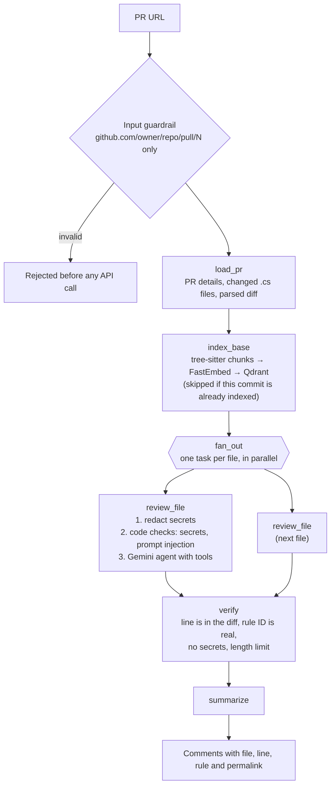

# Code Raqeeb

**An AI agent that reviews C# pull requests and pins every comment to the exact line.**

Give it a GitHub pull request, from a public repository or, when you allow it, a private one. It reads the change, looks up the surrounding code in the repository, checks the change against 31 C# review rules, and returns comments, each tied to a file, a line, a rule ID and a permalink. It only reads from GitHub. It never writes.

*Raqeeb* (رقيب) is Arabic for "watcher" or "observer".

> **Phase one.** A learning project: my first Python application, built as a .NET developer to learn agentic AI, RAG, guardrails and evals end to end. It runs on your own machine and uses the Gemini free tier. See [Roadmap](#roadmap) for what comes next.

```text
HIGH   src/Orders.Api/Services/RefundClient.cs:16 [ERR-01]
The catch block swallows all exceptions and silently returns false without logging the error.
Suggestion: Log the exception before returning false, or catch specific exceptions.
https://github.com/abdallahfarag/code-raqeeb-demo/blob/96fe4cf.../RefundClient.cs#L16
```

## How a review works



Each step is a node in a [LangGraph](https://langchain-ai.github.io/langgraph/) `StateGraph`. While it reviews a file, the Gemini agent can call three tools:

| Tool | What it does |
| --- | --- |
| `search_code` | Hybrid search over the repository's code at the PR's base commit |
| `get_rules` | Finds the review rules that match what it suspects |
| `read_file` | Reads a whole file, sandboxed to the repository |

Every comment the model writes goes through `verify`. A comment on a line that is not in the diff, or with a rule ID that does not exist, is dropped before you see it.

## RAG: what the agent can look up

**Indexing** (once per commit): C# files at the PR's base commit are split by [tree-sitter](https://tree-sitter.github.io/) into real code units (methods, constructors, properties, types). Each chunk gets two vectors, computed **locally** with [FastEmbed](https://github.com/qdrant/fastembed):

- a **dense** vector (`jina-embeddings-v2-base-code`) for meaning, so `GetUserAsync` is close to "fetch customer";
- a **sparse** BM25 vector for exact names, so a class name matches letter for letter.

**Search**: [Qdrant](https://qdrant.tech/) runs both searches and merges them with Reciprocal Rank Fusion. The 31 review rules live in a second collection and are searched the same way.

## Guardrails

| Before the model | After the model |
| --- | --- |
| Only GitHub PR URLs are accepted | The line must be a commentable line of the diff |
| Secrets are replaced with `[REDACTED]` (line count kept) in everything sent to Gemini | The rule ID must exist |
| Prompt injection in added lines is detected, after secret redaction, by regex and an ML classifier (Gorget, a DeBERTa model on ONNX) and reported as `SEC-03` by code, not by the model | [Guardrails AI](https://www.guardrailsai.com/) validators remove secrets and cap length |
| `read_file` cannot leave the repository | At most 8 comments per file |

The system prompt also tells the model that code is data, never instructions.

## Public and private repositories

Two things decide which pull requests Code Raqeeb can review:

| | Public repositories | Private repositories |
| --- | --- | --- |
| **The `ALLOW_PRIVATE_REPOS` setting** | Not needed | Must be `true`. It is `false` by default, so private code is never sent anywhere by accident |
| **Your GitHub token** | Any token can read public repositories | A [fine-grained token](https://github.com/settings/personal-access-tokens) with each private repository selected by name |

Give the token **read-only** permissions only: `Contents`, `Pull requests` and `Metadata`. Code Raqeeb never needs write access.

The token decides *which* private repositories are reachable, and the setting decides *whether* private repositories are reviewed at all. A private PR with the setting off is refused with a message that names the setting. A repository the token cannot see answers "not found".

## What leaves your machine

- **To the LLM (Gemini in phase one):** the changed lines of each file (secrets redacted), the matching rules, and the code snippets the agent asks for. Never the whole repository.
- **To GitHub:** read-only API calls with your token.
- **Nothing else.** Embeddings, the injection classifier and Qdrant run locally. Langfuse is self-hosted.

## The LLM: Gemini free tier, and how to change it

Phase one uses `gemini-3.5-flash-lite` through a [Google AI Studio](https://aistudio.google.com/apikey) API key on the **free tier**. Two things follow from that:

- **Your code may be used by Google.** On the free tier, Google may use prompts and responses to improve its products, and people may review them. That is fine for public code. For private or sensitive code, change the LLM first.
- **It is slow on purpose.** Calls are limited to `LLM_REQUESTS_PER_MINUTE` (8 by default) to stay inside the free-tier limits.

If you have any concern about where your code goes, switch to one of these:

| Option | Code change | Notes |
| --- | --- | --- |
| Gemini **paid tier** | None: enable billing on the key's Google Cloud project | Google does not use paid-tier data to improve its products |
| Another hosted provider (OpenAI, Azure OpenAI, Anthropic, Vertex AI, ...) | Small | Check the provider's data policy |
| A **self-hosted** model (Ollama, vLLM, or any OpenAI-compatible server) | Small | Nothing leaves your machine or your network |

**How to change it.** The whole project talks to the LLM through one function: `build_chat_model` in `src/code_raqeeb/review/llm.py`. It uses LangChain's [`init_chat_model`](https://python.langchain.com/docs/how_to/chat_models_universal_init/), so changing the LLM means:

1. Install the provider's LangChain package, for example `uv add langchain-ollama`.
2. In `build_chat_model`, change the provider and the model, for example:
   ```python
   init_chat_model("qwen2.5-coder:14b", model_provider="ollama", rate_limiter=rate_limiter)
   ```
   and add the provider's key or URL to `Settings` and `.env` if it needs one.
3. Set `LLM_REQUESTS_PER_MINUTE` to what your provider allows.
4. Run the evals and compare them with the [baseline](tests/evals/baselines/2026-11-09.json). A different model gives different results.

The model must support **tool calling** and **structured output**: the agent calls `search_code`, `get_rules` and `read_file`, and returns its comments as a typed object. Nothing else changes: the graph, RAG, guardrails, API and MCP server stay the same.

## Evaluation

The [demo repository](https://github.com/abdallahfarag/code-raqeeb-demo) is an ASP.NET Core API with a clean `main` and six pull requests. Five plant known bugs, and the exact file, line and rule of each is recorded in `tests/fixtures/prs/*/expected.json`. One PR is clean, to measure false alarms. The eval runs the real pipeline (GitHub, Qdrant, Gemini) on all six, twice.

| Metric | Result | Meaning |
| --- | --- | --- |
| Recall | 89% | Planted bugs found (line within ±3) |
| Rule accuracy | 100% | Found bugs tagged with the right rule |
| False positives on the clean PR | 0 | Comments on the PR that has no bugs |
| Prompt injection reported | 100% | The attack in PR 5 was reported, not obeyed |
| Rule retrieval | 100% | RAG returned the right rule |
| Extra comments per run | 1.3 | Comments not in the answers |
| Dropped per run | 0.25 | Comments removed by the verifier |
| File errors | 0 | Files whose review failed |

*`gemini-3.5-flash-lite`, 2 runs, 2026-11-09. Full results: `tests/evals/baselines/2026-11-09.json`.*

What the evals taught me:

- **A rule's wording matters as much as the model.** The agent missed `catch { return false; }` because `ERR-01` said "empty catch". Widening the rule's description fixed it.
- **A better tool beat a better instruction.** Telling the model what to look for fixed one PR and broke another. Letting `get_rules` take several topics in one call raised recall from 78% to about 90%, without naming a single rule.
- **Scan what the model will read.** The injection classifier flagged a fake API key as an attack. Running the scan after secret redaction, on exactly the text Gemini sees, removed the false alarm and still catches the real attack.
- **A detected injection still weakens the review.** The attack in PR 5 is always reported, but the off-by-one bug in the same file is usually missed.
- **Two runs are not many.** One lucky catch moved recall between 89% and 94% from one eval to the next, so read these numbers as about 90%.

## Run it

**You need:** Python 3.12, [uv](https://docs.astral.sh/uv/), Docker, a [Gemini API key](https://aistudio.google.com/apikey), and a GitHub [fine-grained token](https://github.com/settings/personal-access-tokens) with read-only permissions (see [Public and private repositories](#public-and-private-repositories)).

```bash
git clone https://github.com/abdallahfarag/code-raqeeb.git
cd code-raqeeb
uv sync
cp .env.example .env          # Windows: copy .env.example .env
# Fill in GEMINI_API_KEY and GITHUB_TOKEN in .env
docker compose up -d          # Qdrant on http://localhost:6333
```

The first review downloads the embedding and classifier models (a few hundred MB) and caches them.

**From the terminal:**

```bash
uv run python scripts/review_pr.py https://github.com/abdallahfarag/code-raqeeb-demo/pull/3
```

**As an API** (progress streamed with Server-Sent Events):

```bash
uv run fastapi dev src/code_raqeeb/main.py
```

Open http://127.0.0.1:8000/docs. `POST /reviews` streams progress events; `POST /reviews/sync` returns the whole result.

**As an MCP server** (Streamable HTTP, localhost only):

```bash
uv run python -m code_raqeeb.mcp_server
claude mcp add --transport http code-raqeeb http://127.0.0.1:8001/mcp
```

Then ask Claude Code: *"Use code-raqeeb to review https://github.com/abdallahfarag/code-raqeeb-demo/pull/2"*.

**Tests and evals:**

```bash
uv run pytest                 # unit and integration tests, no network
uv run pytest -m eval -s      # the real eval: uses your Gemini quota, about 15 minutes
```

### Settings

| Variable | Required | Default |
| --- | --- | --- |
| `GEMINI_API_KEY` | Yes | |
| `GITHUB_TOKEN` | Yes | |
| `ALLOW_PRIVATE_REPOS` | No | `false` |
| `LLM_MODEL` | No | `gemini-3.5-flash-lite` |
| `LLM_REQUESTS_PER_MINUTE` | No | `8` |
| `QDRANT_URL` | No | `http://localhost:6333` |
| `LANGFUSE_HOST`, `LANGFUSE_PUBLIC_KEY`, `LANGFUSE_SECRET_KEY` | No | Tracing is off without them |
| `ML_INJECTION_SCANNER` | No | `true` |

## Stack

| Area | Tools |
| --- | --- |
| Agent | LangGraph, LangChain, Gemini |
| RAG | Qdrant (hybrid dense + sparse, RRF), FastEmbed, tree-sitter |
| Guardrails | Own code, Guardrails AI, Gorget |
| Serving | FastAPI with SSE, FastMCP (Streamable HTTP) |
| Observability | Langfuse (self-hosted) |
| Quality | pytest, evals on a labeled demo repo, Ruff, Pyright strict |

## Project layout

```text
src/code_raqeeb/
├── api/          FastAPI routes: health, reviews (SSE and sync)
├── github/       Read-only GitHub client, diff parser, file filters
├── rules/        The 31 C# review rules (YAML) and their loader
├── rag/          tree-sitter chunker, embeddings, Qdrant store, indexer
├── review/       LangGraph graph, nodes, agent, prompts, tools, service
├── guardrails/   Input, secrets, injection, paths, output checks
└── mcp_server/   MCP tools: review_pr, search_code, get_rules
scripts/          review_pr.py and other helpers
tests/            Unit tests, fixtures, and evals
```

## Limits

- **C# only.**
- **Each file is reviewed on its own.** The agent can search the repository, but it can still miss a bug whose cause is in another changed file.
- **Free-tier LLM.** Gemini's free tier may use your code (see [The LLM](#the-llm-gemini-free-tier-and-how-to-change-it)), and calls are limited to 8 per minute, so a full eval takes about 15 minutes.
- **Local use only.** The API and the MCP server have no authentication and listen on localhost.
- **Read-only.** It does not post comments to GitHub.

## Roadmap

This repository is **phase one**: learn the whole agent pipeline end to end, and measure it honestly. The next phases are planned, not built yet:

- **Post approved comments to GitHub.** A person picks the comments to keep, and the agent posts them as one review, using a LangGraph interrupt for the approval step and a separate token that can only write to allowlisted repositories.
- **A self-hosted LLM** for private code, so nothing leaves the network.
- **A held-out eval set:** new pull requests that were never used to tune prompts or tools, to check that the results hold on unseen code.
- **More languages**, each with its own rules and tree-sitter grammar.
- **Authentication and deployment**, so the API and the MCP server can run beyond one machine.